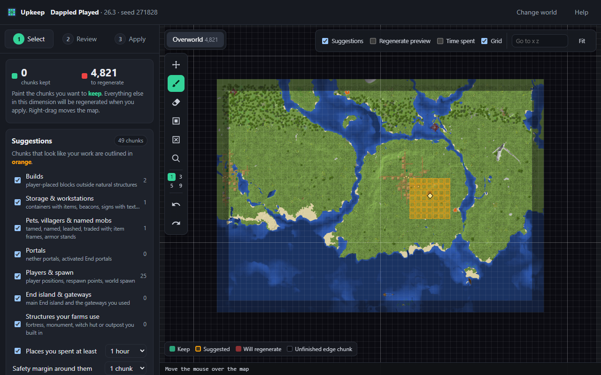
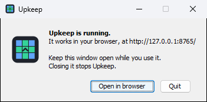
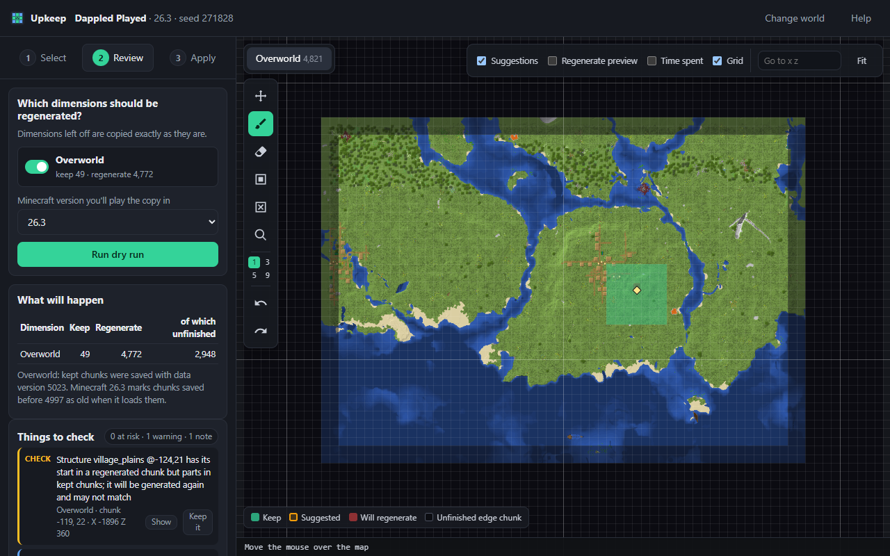
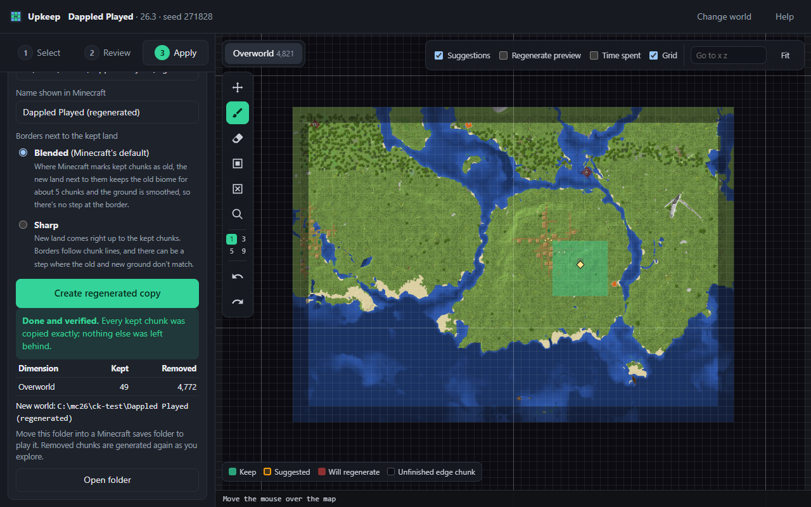

# Upkeep

**Keep what you built. Regenerate the rest.**

Got an old Minecraft: Java Edition world and want the new biomes and structures? Upkeep shows a map of your world, you
mark the chunks you want to keep (it suggests your builds for you), and it makes a **copy** of the world with just
those chunks. Minecraft fills in everything else with brand-new terrain as you explore.

Your original world is never touched.

## Get it

**Windows:** download `Upkeep-<version>-windows-x64.zip` from the
[latest release](https://github.com/estebansa19/upkeep/releases/latest), extract it, and double-click `Upkeep.exe`.
Nothing else to install.

If Windows says "Windows protected your PC", click **More info** → **Run anyway** (the app isn't code-signed yet, see
[Code signing policy](#code-signing-policy)).

**macOS / Linux:** download `upkeep-<version>.jar` and run `java -jar upkeep-<version>.jar` (Java 21+).

**Uninstall:** delete the `Upkeep` folder you extracted (or the jar) and the `Upkeep` folder in your user folder
(`C:\Users\<you>\Upkeep` on Windows, `~/Upkeep` elsewhere), which holds your selections and the map cache. Upkeep
installs nothing else.

## Use it

1. **Close Minecraft** and start Upkeep. This little window pops up and your browser opens the Upkeep page.

   

2. **Pick your world** from the list.
3. **Click Keep suggested chunks.** Your builds, farms, chests and portals are found for you. Paint more with the brush
   if you want.
4. **Review → Run dry run** to double-check nothing important gets lost.
5. **Apply → Create regenerated copy.** A new world called "<world> (regenerated)" shows up next to the old one.

Open Minecraft, load the new world, and go exploring.

| Dry run | Done |
|---|---|
|  |  |

## Good to know

- Everything runs on your computer. Upkeep has no telemetry and doesn't go online, unless you click **Download from
  Mojang** for sharp borders (it then downloads the official Minecraft server from Mojang).
- Keep the small "Upkeep is running" window open while you work. Closing it stops Upkeep.
- Works with worlds from 1.18 on, from the Minecraft Launcher, Prism, CurseForge, Modrinth, or any world folder.
- New land blends into the old by default. Want a clean edge instead? Pick **Sharp** borders on the Apply tab.

Want more? The [guide](docs/guide.md) has every feature, keyboard shortcuts, what to expect at the borders, limitations
and how to build from source. [How it works](docs/how-it-works.md) has the deep dive.

## Code signing policy

Windows releases are built from this repository by GitHub Actions ([release workflow](.github/workflows/release.yml)),
with nothing added by hand. Free code signing by [SignPath.io](https://signpath.io), with a certificate by the
[SignPath Foundation](https://signpath.org), is being set up; until then the Windows app is unsigned and Windows may warn
before the first start. Each release lists SHA-256 checksums.

- Committers and reviewers: [estebansa19](https://github.com/estebansa19)
- Approvers: [estebansa19](https://github.com/estebansa19)

This program will not transfer any information to other networked systems unless specifically requested by the user or
the person installing or operating it (see [Good to know](#good-to-know)).

## License

[MIT](LICENSE). Upkeep is not an official Minecraft product and is not approved by or associated with Mojang or
Microsoft.
