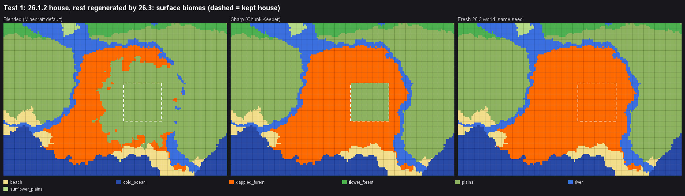
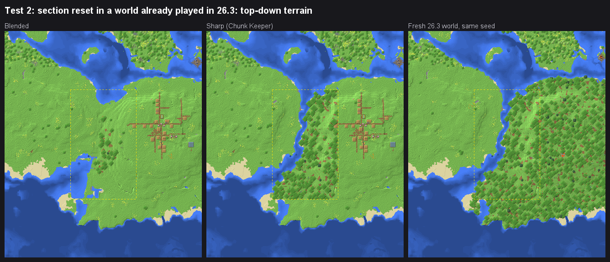

# How regeneration works (and what the borders look like)

These notes come from testing Minecraft 26.1.2 → 26.3 on the same seed with dedicated servers, plus reading both
game jars (data generator reports and the world upgrader code).

## Biomes come from the seed plus the game version's biome table

Since 1.18 the Overworld uses the `multi_noise` biome source. For every 4×4×4 cell the game samples six noise values
from the seed: temperature, humidity, continentalness, erosion, weirdness and depth. The cell gets the biome whose box in
the **parameter list** (preset `minecraft:overworld`, about 7,600 boxes) is nearest to that point.

- The save stores only the preset name, not the list. Each game version brings its own list.
- Same seed means the same noise, so the climate at every spot stays the same across versions. Only the biome assigned to
  that climate changes.
- A new biome either takes over boxes from an existing biome or adds new boxes. Other biomes don't move.

Example: from 26.1.2 to 26.3, two biomes were added and nothing else changed.

| change | detail |
|---|---|
| `plains → dappled_forest` (26.3) | exactly 90 plains boxes replaced one for one (cool, dry plains) |
| `sulfur_caves` (26.2) | one new box (deep underground, low weirdness, high erosion) |

On a 2,304-chunk test area, 7.2 % of biome cells changed. Nearly all were `plains → dappled_forest` or `… → sulfur_caves`,
plus about 0.006 % tie-breaks at biome borders. Terrain height was identical.

## What happens to chunks

| chunk | result |
|---|---|
| already generated and kept | never changes |
| deleted, then regenerated far from kept chunks | identical to a fresh world of the new version |
| regenerated next to kept chunks the new version marks "old" | **blended**, see below |
| regenerated next to kept chunks with **Sharp** borders | identical to a fresh world right up to the kept chunks |
| unfinished edge chunk (generated only partway by the old version) | finished by the new version but **keeps the old biomes** |
| regenerated with the same version that generated the kept chunks | identical to a fresh world, with no blending |

## Blending

When a new version loads an Overworld chunk older than a certain data version, it adds a `blending_data` tag. The marker
moves with releases that change world generation: it was at DataVersion 4295 in 26.1.2 and 4997 in 26.3. New chunks
generated next to tagged chunks are blended:

| distance from kept chunk | cells with the old biome (where old ≠ new) |
|---:|---:|
| 1 chunk | 90 % |
| 2 chunks | 80 % |
| 3 chunks | 59 % |
| 4 chunks | 27 % |
| 5 chunks | 2 % |
| 6+ chunks | 0 % |

The terrain is reshaped too, even when the terrain generator did not change. On average it is about 4 blocks off from
the true terrain within about 100 blocks of the seam, and up to 50+ blocks at single spots. The seam itself is smooth: no
cliff. Some odd biome streaks can appear.

The Nether and End are never blended.

## Sharp borders

The tag is added **when a version loads the chunk**, and only to chunks saved before that version's marker. Upkeep
reads the marker from the installed game (`DataFixers.BLENDING_VERSION` in the client jar), so the dry run can tell which
case you are in for the version you'll play the copy in:

- **Kept chunks already saved by that version** (for example, you reset part of a world you already play in 26.3): the
  game won't mark them again, so **Sharp** simply removes the marks they carry.
- **Kept chunks from an older version** (an upgrade): removing the marks alone doesn't help, because the game adds them
  back on the first load. Tested with 26.1.2 → 26.3: all 49 kept chunks were marked again and the dappled forest started
  about 9 chunks from the kept area. So **Sharp** first runs that version's official server once on the new copy with
  `--forceUpgrade --recreateRegionFiles`. It re-saves every existing chunk in the new format (adding the marks) and
  generates nothing. Upkeep then removes the marks and checks that every kept chunk was re-saved.

`--recreateRegionFiles` matters. Without it, the 26.3 upgrader doesn't wait for its last chunk write, and in a 49-chunk
copy the last chunk stayed at the old version 3 times out of 3. The in-game **Optimize World** button has no such option.

Sharp borders follow chunk lines. Where the new version shapes the ground differently there can be a step, and trees
from the old kept chunks don't reach across the border the way they would in a fresh world.

### Measured

Both tests: Dappled Test (seed 271828), 26.3 server, compared cell by cell with a fresh 26.3 world of the same seed.

**Upgrade.** A house kept from 26.1.2, everything else regenerated by 26.3. Distance from the kept chunks:

| chunks away | biome = fresh 26.3 (blended) | (sharp) | ground height off (blended) | (sharp) |
|---:|---:|---:|---:|---:|
| 1 | 0 % | 100 % | 4.7 | 1.4 |
| 2 | 0 % | 100 % | 5.3 | 0.5 |
| 3 | 20 % | 100 % | 5.5 | 0.5 |
| 4 | 53 % | 100 % | 4.3 | 0.4 |
| 5 | 92 % | 100 % | 3.7 | 0.3 |
| 6 | 99 % | 100 % | 2.0 | 0.5 |
| 7+ | 100 % | 100 % | ≤ 0.6 | ≤ 0.3 |

All 32 chunks touching the house became dappled forest with Sharp, and none with Blended. After 26.3 opened the sharp
copy, no chunk was marked again.

**Section reset in a world already played in 26.3.** Every chunk of the copy had been saved by 26.3 (and marked). A
9 × 15-chunk plains section that is dappled forest in a fresh 26.3 world was regenerated. Rows in from the section's edge:

| rows in | biome = fresh 26.3 (blended) | (sharp) | ground height off (blended) | (sharp) |
|---:|---:|---:|---:|---:|
| 1 | 38 % | 100 % | 4.2 | 1.0 |
| 2 | 36 % | 100 % | 7.4 | 0.2 |
| 3 | 38 % | 100 % | 8.7 | 0.1 |
| 4 | 58 % | 100 % | 7.1 | 0.0 |
| 5 (middle) | 95 % | 100 % | 7.8 | 0.0 |

With Sharp no server step was needed, only the marks were removed, and all 77 chunks that are fully dappled forest in a
fresh world were dappled forest. With Blended, the first three rows had none.

## Regenerated neighbours can touch the edge of kept chunks

When Minecraft generates a chunk, some of its features reach into neighbouring chunks: ore and stone-variety blobs
(granite, diorite, andesite, coal ore, gravel and dirt pockets) and trees. That also happens when the neighbour is a chunk you
kept. In an end-to-end test (26.3 world, 541 kept chunks next to 3,555 regenerated ones), about 9,400 blocks changed inside
kept chunks:

- only natural stone, ore and soil blocks, never player-type blocks
- nearly all within 1–5 blocks of the border, and none deeper than 8 blocks

A build made of stone-type blocks right at the edge of the kept area could get patched, which is why suggestions add a
**1-chunk safety margin** by default.

In the same test, every removed chunk was regenerated with biomes identical to the original (same version and seed), and the
regenerated terrain matched the original apart from the order-dependent spots above (0.3 % of blocks).

## Other things at the seams

- **Water and lava** at the edge of a kept chunk can flow into lower regenerated terrain. The dry run lists these edges.
- **Structures** store their start in one chunk and are referenced from the others. If the start is regenerated but some
  pieces are kept, the structure is generated again and may not line up. The dry run warns about this; mineshafts and
  other minor structures are left out of the warnings.
- **Farms** that depend on a structure (fortress, monument, witch hut, pillager outpost) need its start chunk kept.
  Suggestions add it automatically.
- **Portals**: the dry run warns when a kept portal's partner in the other dimension would be regenerated.
- **End**: keep the main island, which holds the exit portal, the pillars and the dragon fight data, plus the outer chunks
  where your gateways exit. Regenerated outer islands bring back end cities with fresh loot.

## Sources

- Minecraft Wiki: [World generation](https://minecraft.wiki/w/World_generation), [Java Edition 22w11a](https://minecraft.wiki/w/Java_Edition_22w11a)
  (3D biome blending; `blending_data` marks old chunks), [Java Edition 21w39a](https://minecraft.wiki/w/Java_Edition_21w39a),
  [Sulfur Caves](https://minecraft.wiki/w/Sulfur_Caves), [Dappled Forest](https://minecraft.wiki/w/Dappled_Forest).
- [Minecraft 1.18 Pre-release 1](https://www.minecraft.net/en-us/article/minecraft-1-18-pre-release-1) (biome blending FAQ).
- Discontinued Features Wiki: [Old Blending Chunks](https://mcdf.wiki.gg/wiki/Java_Edition:Old_Blending_Chunks).
- Mojang bug tracker: MC-244340, MC-258585.
